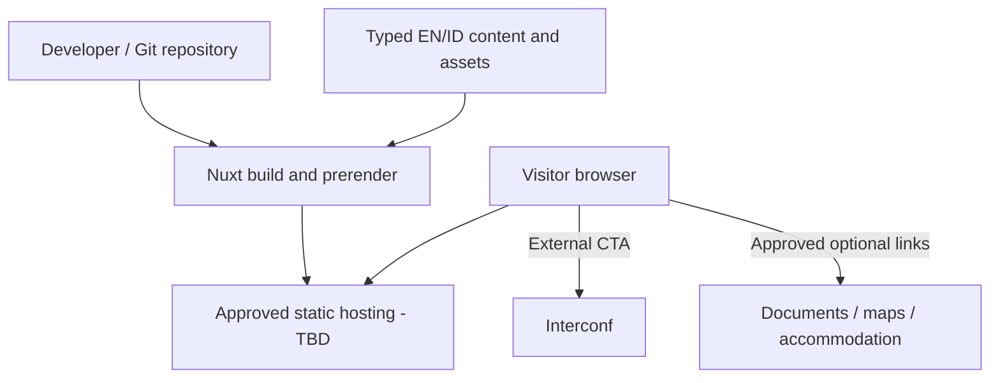
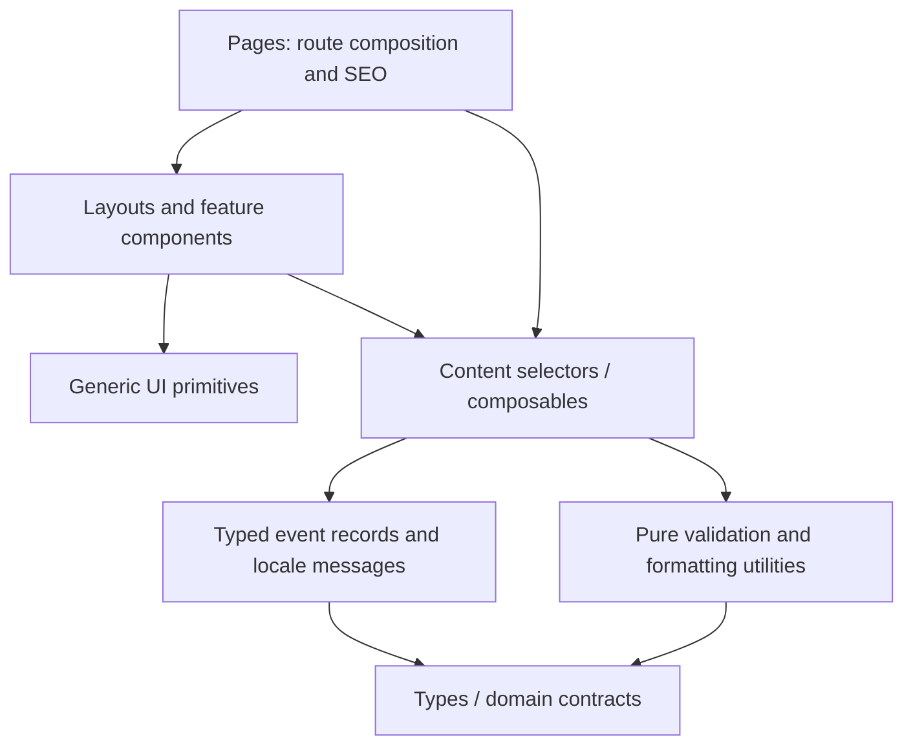

# 07 — System Architecture

Version 0.2 | Phase 2 PoC implemented | Production architecture and release verification pending

## Phase 2 proof of concept

- Installed exact versions: `@nuxtjs/i18n 10.7.0`, `typescript 5.9.3`, and `vue-tsc 3.3.14`. The i18n package requires Node >=20.11.1 and brings Nuxt Kit ^4.7.0 and Vue Router ^5.5.1, compatible with the existing Nuxt/Router versions. The TypeScript version meets vue-tsc's TypeScript >=5.0.0 peer range. Windows verification used Node 26.13.1 and npm 12.2.3. Nuxt's locked Node engines are `^22.22.3 || ^24.15.0 || >=26.0.0`.
- `app.vue` provides the Nuxt shell, `layouts/default.vue` the shared layout, and `pages/index.vue` the temporary verification page. `components/LanguageSwitcher.vue` uses the module's equivalent-route helper. The verification page carries `noindex, nofollow`.
- `ssr: true` and explicit prerender routes produce `en/index.html` and `id/index.html`. The root route is excluded from generation. The production root redirect and 404 configuration are host decisions. See [routing](16-ROUTING-AND-INTEGRATIONS.md).
- A runtime validator checks an isolated fixture using Node's built-in test runner. The verification page does not import the fixture. See [data contracts](13-DATA-ARCHITECTURE.md).

| Command or check | Exit | Observed result |
|---|---:|---|
| `git rev-parse --verify HEAD` | 128 | No initial commit. Source baselines for edited files were copied outside the repository and checked with SHA-256 before editing. |
| `npm install --save-exact @nuxtjs/i18n@10.7.0` and `npm install --save-dev --save-exact typescript@5.9.3 vue-tsc@3.3.14` | 0 each | Existing package versions in the lockfile were preserved. The policy blocked an esbuild 0.25.12 dependency script. |
| `npm ci --offline --no-audit --logs-max=0` | 0 | Clean install and `nuxt prepare` completed in an isolated temporary copy using the populated npm cache. The script policy stayed in effect. |
| `npm ls --depth=0` | 0 | All eight expected direct packages were present at the selected versions. |
| `npm run test:content` | 0 | Five tests passed. |
| `npm run typecheck` | 0 | Nuxt checker completed. |
| `node node_modules/typescript/bin/tsc --noEmit --strict --target esnext --module nodenext --allowImportingTsExtensions tests/fixtures/conference.ts app/utils/content-validation.ts` | 0 | The isolated fixture and validator also passed strict TypeScript checking. The Node test runner is an ES module and needs no extra Node type package. |
| `npm run generate` | 0 | Eight routes generated, including both HTML pages and both static message JSON files. |
| `node <temporary-directory>/static-check.mjs` | 0 | The Node static server served only files from `.output/public/`. Chrome headless 158.0.8127.37 verified direct load and refresh, the disclosure after Vue hydration, EN ↔ ID navigation within the same document, and both static message responses. The server returned HTTP 404 and Chrome rendered the fallback for an unknown route. |
| `npm audit --json` | 1 | Nine moderate findings in the dependency tree. See [security](17-SECURITY.md). |

The static probe checked the rendered `h1`, HTML `lang`, switcher destination, and robots meta before opening Chrome. It then observed both hashed catalog URLs return HTTP 200 and checked for browser errors and hydration warnings on the known routes. The probe used a temporary script and browser profile on loopback, outside the application and repository. It does not establish production-host behavior or cross-browser coverage.

Nuxt reported plugin metadata optimization warnings `NUXT_B2010` and `NUXT_B2014`. Generation also reported a Nitro cache-driver externalization warning and overlapping diagnostic timer labels. Generation still completed. Record and re-evaluate the warnings in CI. Production domain, redirect provider, content, brand, and SEO remain pending.

Baseline: [requirements](01-REQUIREMENT-ANALYSIS.md), [scope](04-PROJECT-SCOPE.md), [NFR](03-NON-FUNCTIONAL-REQUIREMENTS.md).

## 1. System context



Proposed: modular Nuxt application, build-time content and public static output. No internal API, database, login, payment or CMS for MVP. Interconf is outside the system boundary; no collection of participant credentials. Analytics optional, pending approval.

## 2. Proposed folder structure

```text
app/
  assets/css/main.css
  components/{common,home,conference,ui}/
  composables/
  data/
  layouts/default.vue
  pages/
  types/
  utils/
  app.vue
public/
  images/
  logos/
  documents/
i18n/                   # Proposed; module configuration TBD
  locales/{en,id}.json
tests/                 # Node content tests and isolated fixtures; E2E tooling is proposed
doc/
nuxt.config.ts
AGENTS.md              # Repository instructions prepared during Phase 2
```

The PoC establishes the app shell, layout, page, language switcher, locale catalogs, types, and validator. Create additional folders as features need them. Shared UI components accept props, pages assemble components, and composables handle reusable logic.

## 3. Rendering and localization decisions

| Topic | Proposal | Validation required |
|---|---|---|
| Public pages | SSG/prerender, HTML available before JS | Production build and both locales generated |
| Interactions | Vue hydration for menus, tabs, accordion | No hydration mismatch; keyboard support |
| i18n | Evaluate @nuxtjs/i18n, EN/ID, both prefixed routes | Installed version compatibility; verify locale config and URL scheme |
| Default locale | EN, root redirect or entry page | Mentor approval; host supports chosen behavior |
| Content | Typed TS/JSON data, shared stable IDs, localized fields | Validation for required translations and official data |
| SEO | Locale-specific title, canonical and reciprocal hreflang | Generated HTML audit |
| Host | Static hosting first; SSR only if justified by new scope | IT approval, direct URLs, 404, HTTPS, cache, rollback |

Do not install dependencies until local versions and scripts are inspected. No dynamic server API if deployed as static files. Verify prerender routes explicitly, including locales not discovered by crawling.

## 4. Data architecture

```ts
type Locale = 'en' | 'id'
type Localized<T = string> = Record<Locale, T>
type RegistrationStatus = 'tba' | 'open' | 'closed'
interface MediaAsset {
  src: string
  alt: Localized
  width: number
  height: number
}
interface Speaker {
  id: string
  name: string
  role: Localized
  institution: Localized
  photo?: MediaAsset
  status: 'confirmed' | 'tbc'
}
type Registration =
  | { status: 'open'; url: string }
  | { status: 'tba' | 'closed'; url?: never }
```

The speaker and media examples illustrate the broader design. The PoC uses the registration union and an independent login availability union. Use stable IDs for sessions/speakers, shared dates with explicit event timezone, shared fee amount and currency, localized labels, and approved asset paths. Separate UI translation keys from event content. Validate data references, links, status, required locales and publication permissions before build/release.

## 5. Phase 2 exit checklist

- [x] Inspect package.json, lockfile, Node/npm versions, Git status and config.
- [x] Record local compatibility and audit results.
- [x] Implement and generate the bilingual SSG PoC.
- [x] Verify the generated output on a local static server in Chrome.
- [x] Record decisions and prepare the root AGENTS.md.
- [ ] Review moderate audit findings and confirm the CI runtime.
- [ ] Approve production root/404 policy, host constraints and production content contracts.

## 6. Layer contracts and dependency direction



| Layer | Responsibility | Must not do |
|---|---|---|
| pages | Compose sections, define page metadata, handle route context | Repeat event data or implement large business logic blocks |
| layouts | Shared site shell, skip link, navbar, footer | Duplicate route-specific content |
| components/ui | Generic accessible buttons, links, accordion, tabs, status | Import specific event records |
| components/conference | Present typed speaker, session, fee, document or venue props | Hardcode official values or fetch credentials |
| composables | Locale-aware selectors and reusable reactive UI logic | Directly mutate immutable event data |
| data | Canonical conference records, approved external links | Import Vue components or browser APIs |
| utils | Deterministic formatters, link validation, sorting | Depend on DOM or network when used at build time |
| types | Shared contracts | Runtime dependencies on UI |

Pages and layout may call selectors. Generic components receive props and emit events; avoid importing pages from components. Keep pure domain logic usable in unit tests. No repository/service abstraction merely to imitate the Laravel portal; introduce abstraction only if a second real source is needed.

## 7. Request lifecycle and failure modes

1. Developer edits EN/ID records, messages and approved assets; review changes in Git.
2. CI installs pinned dependencies, validates schemas, runs configured checks, generates all public routes.
3. Nuxt renders HTML and static payloads at build time. Host serves requested locale URL plus CSS/JS/assets.
4. Browser hydrates Vue; interactions such as tabs and language switching use client state. Initial content must be deterministic between build and browser.
5. External registration links are handed off to Interconf. No credential, participant or payment data returns to this application.
6. Update content by generating and deploying a new immutable release. Restore prior artifact if critical failure.

| Failure | Required behavior |
|---|---|
| Missing required translation or invalid reference | Fail content-validation gate before publishing |
| Unconfirmed event data | Approved localized TBA state, not fake values |
| Missing image | Accessible approved fallback; avoid broken image icon |
| Missing document | Display unavailable state, no clickable dead link |
| Interconf unavailable | Keep conference info available; display approved contact/status after committee confirmation |
| Invalid URL | Host returns real 404; localized recovery navigation if feasible |
| Hydration mismatch | Investigate and fix before release; avoid time/random/window during initial render |

## 8. Code governance (proposed)

Use separation of concerns and single source of truth. Review page files above 250 LOC, components above 200, composables/utilities above 150; consider refactor above 400 LOC for pages, but treat as review heuristics rather than artificial mandatory splits. Generated files, locale JSON and data records excluded. Prefer clear small components over one-line compression. No new global store unless multiple distant components need shared mutable state. Do not use index as key for changing lists; stable IDs required. No direct DOM access outside appropriate lifecycle and no global request-specific mutable state. Test changes at route and component boundaries.

## 9. Architecture decision register

| ADR | Decision | State | Alternative / tradeoff |
|---|---|---|---|
| ADR-001 | Nuxt 4 + Vue 3 + TypeScript + Tailwind v4 | Developer validated | Existing ecosystem preferred |
| ADR-002 | Build-time static rendering, hydration for interactions | Implemented for PoC | SSR enables runtime content but adds server operations |
| ADR-003 | EN/ID prefixed locale routes, default EN, detection disabled | Implemented for PoC; production root policy pending | Unprefixed EN gives shorter URLs and asymmetric routing |
| ADR-004 | Source-code typed content; no DB/CMS | Developer validated scope; schema draft | CMS requires scope change |
| ADR-005 | External Interconf integration through links | Developer validated | No internal participant flow |
| ADR-006 | Static host and immutable artifact releases | Proposed; host TBD | SSR deployment only if approved |
| ADR-007 | UI library/icon/image tooling | TBD | Prefer existing dependencies; assess accessibility and bundle |
| ADR-008 | No analytics before approval | Proposed privacy safeguard | Real counter only with policy and integration |

## 10. Phase 2 inspection procedure

In repository root, read `package.json`, lockfile, `nuxt.config.ts`, `.gitignore`, existing CSS and app tree. Run `git status`, `node -v`, `npm -v`, `npm run`, `npm ls --depth=0` and review `npm audit` findings without auto-fix. Capture Node engine warnings and blocked install scripts; do not blindly approve scripts or use `npm audit fix --force`. Record actual versions, not those from reference portal. Confirm current build and local configuration with developer before changing files. Use [data contract](13-DATA-ARCHITECTURE.md), [i18n](14-BILINGUAL-TRANSLATION.md), [routing](16-ROUTING-AND-INTEGRATIONS.md) and [agent draft](21-AGENTS-DRAFT.md) for decisions. Official reference: https://nuxt.com/docs/4.x/ and https://i18n.nuxtjs.org/docs/guide .
