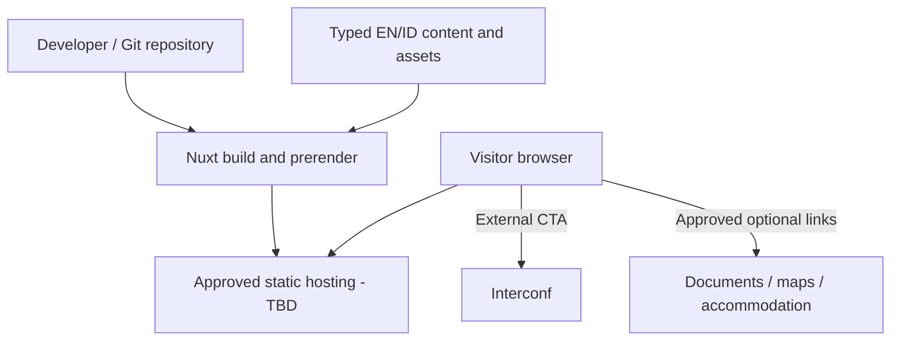
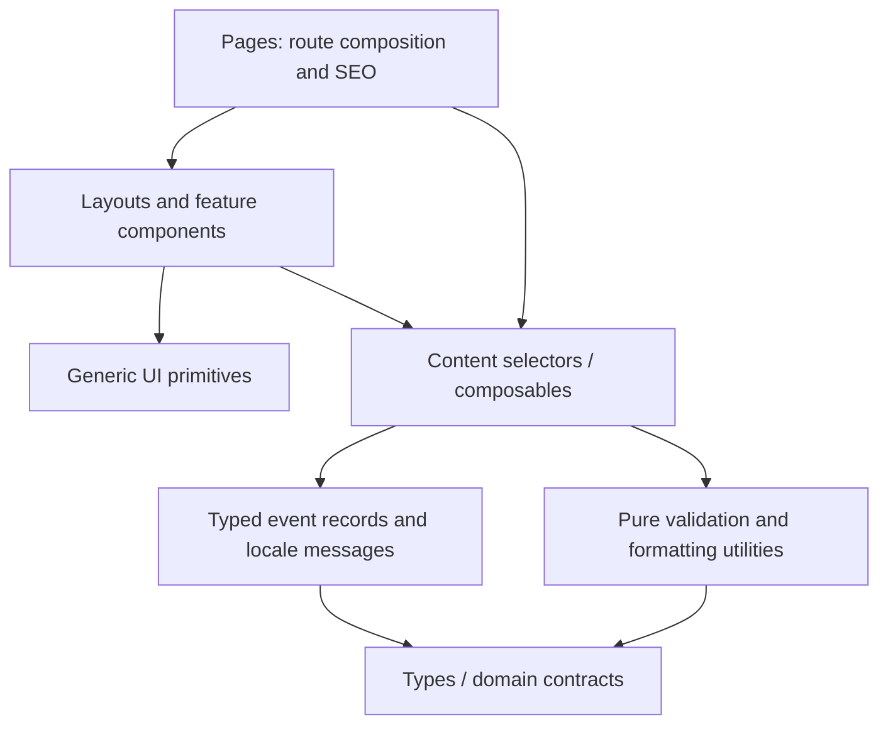

# 07 — System Architecture

Version 0.3 | 2026-11-27 | Review recommendation: **Phase 2 Conditionally Approved** | Reviewer sign-off pending

## Phase 2 implementation record

- Installed exact versions: `@nuxtjs/i18n 10.7.0`, `typescript 5.9.3`, and `vue-tsc 3.3.14`. The i18n package requires Node >=20.11.1 and brings Nuxt Kit ^4.7.0 and Vue Router ^5.5.1, compatible with the existing Nuxt/Router versions. The TypeScript version meets vue-tsc's TypeScript >=5.0.0 peer range. Windows verification used Node 26.13.1 and npm 12.2.3. Nuxt's locked Node engines are `^22.22.3 || ^24.15.0 || >=26.0.0`.
- `app.vue` provides the Nuxt shell, `layouts/default.vue` the shared layout, and `pages/index.vue` the temporary verification page. `components/LanguageSwitcher.vue` uses the module's equivalent-route helper. The verification page carries `noindex, nofollow`.
- `ssr: true` and explicit prerender routes produce `en/index.html` and `id/index.html`. The root route is excluded from generation. The production root redirect and 404 configuration are host decisions. See [routing](16-ROUTING-AND-INTEGRATIONS.md).
- A runtime validator checks an isolated fixture using Node's built-in test runner. The verification page does not import the fixture. See [data contracts](13-DATA-ARCHITECTURE.md).

| Command or check | Exit | Observed result |
|---|---:|---|
| `git rev-parse --verify HEAD` | 128 | No initial commit at the time of PoC implementation. Source baselines were checked with SHA-256 before edits. See the later Git result below. |
| `npm install --save-exact @nuxtjs/i18n@10.7.0` and `npm install --save-dev --save-exact typescript@5.9.3 vue-tsc@3.3.14` | 0 each | Existing package versions in the lockfile were preserved. The policy blocked an esbuild 0.25.12 dependency script. |
| `npm ci --offline --no-audit --logs-max=0` | 0 | Clean install and `nuxt prepare` completed in an isolated temporary copy using the populated npm cache. The script policy stayed in effect. |
| `npm ls --depth=0` | 0 | All eight expected direct packages were present at the selected versions. |
| `npm run test:content` | 0 | Five tests passed. |
| `npm run typecheck` | 0 | Nuxt checker completed. |
| `node node_modules/typescript/bin/tsc --noEmit --strict --target esnext --module nodenext --allowImportingTsExtensions tests/fixtures/conference.ts app/utils/content-validation.ts` | 0 | The isolated fixture and validator also passed strict TypeScript checking. The Node test runner is an ES module and needs no extra Node type package. |
| `npm run generate` | 0 | Eight routes generated, including both HTML pages and both static message JSON files. |
| `node <temporary-directory>/static-check.mjs` | 0 | The Node static server served only files from `.output/public/`. Chrome headless 158.0.8127.37 verified direct load and refresh, the disclosure after Vue hydration, EN ↔ ID navigation within the same document, and both static message responses. The server returned HTTP 404 and Chrome rendered the fallback for an unknown route. |
| `npm audit --json` | 1 | Nine moderate findings in the dependency tree. See [security](17-SECURITY.md). |

The static probe checked the rendered `h1`, HTML `lang`, switcher destination, and robots meta before opening Chrome. It then observed both hashed catalog URLs return HTTP 200 and checked for browser errors and hydration warnings on the known routes. The probe used a temporary script and browser profile on loopback, outside the application and repository. It does not establish production-host behavior or cross-browser coverage.

Nuxt reported plugin metadata optimization warnings `NUXT_B2010` and `NUXT_B2014`. Generation also reported a Nitro cache-driver externalization warning and overlapping diagnostic timer labels. Generation still completed. Record and re-evaluate the warnings in CI. Production domain, redirect provider, content, brand, and SEO remain pending.

Baseline: [requirements](01-REQUIREMENT-ANALYSIS.md), [scope](04-PROJECT-SCOPE.md), [NFR](03-NON-FUNCTIONAL-REQUIREMENTS.md).

## Phase 2 closure verification

Application baseline `595808f8efcd00355af6ffccf1d0a0af494fdcae` on `main`, matching the local `origin/main` tracking ref. The working tree was clean at inspection. A local `.gitignore` edit appeared during the review and was preserved. The closure review used Windows, Node `24.15.0`, npm `11.12.1` and Git `2.51.0.windows.2`. No CI runner or standard runtime has been approved.

| Command or check | Exit | Observed result |
|---|---:|---|
| `git rev-parse --verify HEAD`, `git log --oneline --decorate -5`, `git status --short --branch` | 0 each | Initial commit exists. Application baseline and current worktree inspected. |
| `npm.cmd run typecheck` | 0 | No TypeScript errors. `NUXT_B2010` and `NUXT_B2014` reproduced. |
| `npm.cmd run test:content` | 0 | Five tests passed with zero failures. |
| `npm.cmd run generate` | 0 | Eight prerendered routes. Both Nuxt plugin diagnostics, Nitro cache-driver externalization, and paired i18n timer warnings reproduced. |
| `node <temporary-directory>/check-public.mjs` | 0 | Verified SSR HTML title, h1, `lang`, translated navigation and reciprocal switch links, locale catalog parity, `noindex`, both message JSONs, and fallback file. Root HTML and `.output/server` were absent. Scanned 20 text assets including six JS chunks for fixture and matcher markers. No matches. |
| `npm.cmd ls minimatch --all --logs-max=0`, `npm.cmd explain minimatch --logs-max=0` | 0 each | Two installed copies. The nested `10.2.6` is the affected copy. |
| `npm.cmd audit --json --fetch-retries=0 --fetch-timeout=12000 --logs-max=0` | 1 | Registry audit available. Nine moderate entries from one advisory. No high or critical entries. See [security triage](17-SECURITY.md). |

The browser navigation and hydration evidence in the implementation record and prior development-environment report applies to the same application baseline. Closure repeated the checks above. Full cross-browser tests, production-host behavior, SEO, and UAT remain Phase 5/6 work. The repository has no lint or E2E script.

### Architecture quality review

| Area | Finding and follow-up |
|---|---|
| Composition and state | The shell delegates to the layout and page. The layout owns HTML language and the shared switcher. The page uses a local `ref` for a single disclosure, and the switcher uses the module route helper. No parallel state store or redundant route implementation was found. |
| Locale consistency | Configuration, explicit prerender routes and the typed data locale list each encode EN/ID. Catalog keys are currently in parity. Check alignment if locale support changes. Layout `lang` and link `hreflang` work for the PoC. Production canonical and head-level reciprocal alternates still require separate verification. |
| Content validation | The validator and domain types are exercised by tests. The PoC page reads UI messages, and `generate` has no production content validation gate. Connect approved records and enforce references, asset rules, and exact approved Interconf destinations when production content is implemented. |
| Publishing boundary | `noindex, nofollow` applies to the verification page. Preview access controls belong to the host. `robots.txt` alone cannot restrict access. Verify DevTools output, public artifact contents and metadata on the release candidate. |
| Dependency version evidence | The installed Nitro package manifest and lockfile report `2.14.0`. `.output/nitro.json` reports Nitro `2.13.6`, which matches the literal in `nitropack/dist/meta/index.mjs`. Use the installed manifest and resolved tree for audit versions. Recheck generated metadata on the agreed CI runner. |
| Documentation fit | The original Phase 1 roadmap still reflects its snapshot before the first commit. This review records current evidence here. `doc/` is the actual path. Broader speaker, schedule, publication and editorial models remain drafts. |

### Reproduced warnings

| Diagnostic | Meaning and verification follow-up |
|---|---|
| `NUXT_B2010` | Nuxt cannot statically extract plugin metadata from generated `#build/components.plugin.mjs` and uses runtime metadata. Track on CI and retest component behavior after dependency changes. |
| `NUXT_B2014` | The i18n runtime plugin's `parallel` metadata is not statically resolvable by the Nuxt optimizer. Typecheck and generation succeeded. Recheck on the agreed CI runtime before changing plugin or framework versions. |
| Nitro `cache-driver.mjs` externalization | On Windows, Nuxt's Nitro adapter supplies a `file:` URL. Rollup's virtual storage module reports it as unresolved and treats it as external. The local static artifact was created and contains no server entry. Verify generation on the selected runner and investigate if deployment adds server or cache behavior. |
| `i18n:beforeLocaleSwitch` timer warnings | The same diagnostic timer label was started more than once and an ensuing `timeEnd` found no timer. Overlapping hook instrumentation during prerender is consistent with these messages. Both locales generated correctly. Recheck in CI and confirm repeated locale switching in Phase 5. |

## 1. System context



The local baseline uses a modular Nuxt application and public static output. The MVP excludes an internal API, database, login, payment and CMS. The external Interconf handoff will use approved links. Analytics remains optional and pending approval.

## 2. Proposed folder structure

```text
app/
  assets/css/main.css
  components/{common,home,conference,ui}/
  composables/
  data/
  layouts/default.vue
  pages/
  types/
  utils/
  app.vue
public/
  images/
  logos/
  documents/
i18n/                   # Nuxt i18n catalogs implemented
  locales/{en,id}.json
tests/                 # Node content tests and isolated fixtures; E2E tooling is proposed
doc/
nuxt.config.ts
AGENTS.md              # Repository instructions prepared during Phase 2
```

The PoC establishes the app shell, layout, page, language switcher, locale catalogs, types, and validator. Create additional folders as features need them. Shared UI components accept props, pages assemble components, and composables handle reusable logic.

## 3. Rendering and localization decisions

| Topic | Decision or proposal | Verification or remaining work |
|---|---|---|
| Public pages | SSG/prerender, HTML available before JS | Both locale pages generated locally. Verify the full route inventory on CI and host. |
| Interactions | Vue hydration for interactive components | Disclosure and language switching verified. Future menus, tabs and accordions require Phase 5 QA. |
| i18n | `@nuxtjs/i18n`, EN/ID with both routes prefixed | PoC configuration and output verified locally. |
| Default locale | EN with browser detection disabled | Local i18n default verified. Production root redirect or entry remains an external decision. |
| Content | Local typed data and source-code editorial workflow | Fixture and minimal validator verified. Production schema, wiring and content approval are pending. |
| SEO | Locale-specific title, canonical and reciprocal hreflang | Generated HTML audit |
| Host | Static hosting first; SSR only if justified by new scope | IT approval, direct URLs, 404, HTTPS, cache, rollback |

Do not install dependencies until local versions and scripts are inspected. No dynamic server API if deployed as static files. Verify prerender routes explicitly, including locales not discovered by crawling.

## 4. Data architecture

```ts
type Locale = 'en' | 'id'
type Localized<T = string> = Record<Locale, T>
type RegistrationStatus = 'tba' | 'open' | 'closed'
interface MediaAsset {
  src: string
  alt: Localized
  width: number
  height: number
}
interface Speaker {
  id: string
  name: string
  role: Localized
  institution: Localized
  photo?: MediaAsset
  status: 'confirmed' | 'tbc'
}
type Registration =
  | { status: 'open'; url: string }
  | { status: 'tba' | 'closed'; url?: never }
```

The speaker and media examples illustrate the broader design. The PoC uses the registration union and an independent login availability union. Use stable IDs for sessions/speakers, shared dates with explicit event timezone, shared fee amount and currency, localized labels, and approved asset paths. Separate UI translation keys from event content. Validate data references, links, status, required locales and publication permissions before build/release.

## 5. Phase 2 closure checklist

- [x] Confirm the initial commit, application baseline, lockfile and local runtime. Preserve local developer edits.
- [x] Verify the bilingual SSG PoC, typecheck, content tests, generated locale HTML and fixture exclusion. Retain prior local Chrome evidence.
- [x] Triage the nine moderate entries and document reachability, limits, remediation options and Phase 5/6 disposition.
- [x] Synchronize ADRs and the root `AGENTS.md` with the repository and document known warnings.
- [ ] Obtain developer or designated reviewer sign-off for conditional closure and authorization to start Phase 3.
- [ ] Confirm official branding before high-fidelity approval. Obtain official event content, translations, asset permissions and Interconf URLs before the applicable production acceptance tests.
- [ ] Phase 5: verify the release candidate on the approved CI runner. Re-audit dependencies, check generated content and browser coverage, and test staging routing, headers, security and official links.
- [ ] Phase 6: obtain IT sign-off on hosting/domain, root redirect and 404, headers, CI runtime, security disposition and release evidence. Verify rollback and production smoke when authorized.

**Recommendation — Phase 2 Conditionally Approved.** The verified technical baseline can support Phase 3 sitemap, flows and wireframes after authorization. Official brand assets are required for high-fidelity approval. The pending external decisions and production checks remain release gates.

## 6. Layer contracts and dependency direction



| Layer | Responsibility | Must not do |
|---|---|---|
| pages | Compose sections, define page metadata, handle route context | Repeat event data or implement large business logic blocks |
| layouts | Shared site shell, skip link, navbar, footer | Duplicate route-specific content |
| components/ui | Generic accessible buttons, links, accordion, tabs, status | Import specific event records |
| components/conference | Present typed speaker, session, fee, document or venue props | Hardcode official values or fetch credentials |
| composables | Locale-aware selectors and reusable reactive UI logic | Directly mutate immutable event data |
| data | Canonical conference records, approved external links | Import Vue components or browser APIs |
| utils | Deterministic formatters, link validation, sorting | Depend on DOM or network when used at build time |
| types | Shared contracts | Runtime dependencies on UI |

Pages and layout may call selectors. Generic components receive props and emit events; avoid importing pages from components. Keep pure domain logic usable in unit tests. No repository/service abstraction merely to imitate the Laravel portal; introduce abstraction only if a second real source is needed.

## 7. Request lifecycle and failure modes

1. Developer edits EN/ID records, messages and approved assets; review changes in Git.
2. CI installs pinned dependencies, validates schemas, runs configured checks, generates all public routes.
3. Nuxt renders HTML and static payloads at build time. Host serves requested locale URL plus CSS/JS/assets.
4. Browser hydrates Vue; interactions such as tabs and language switching use client state. Initial content must be deterministic between build and browser.
5. External registration links are handed off to Interconf. No credential, participant or payment data returns to this application.
6. Update content by generating and deploying a new immutable release. Restore prior artifact if critical failure.

| Failure | Required behavior |
|---|---|
| Missing required translation or invalid reference | Fail content-validation gate before publishing |
| Unconfirmed event data | Approved localized TBA state, not fake values |
| Missing image | Accessible approved fallback; avoid broken image icon |
| Missing document | Display unavailable state, no clickable dead link |
| Interconf unavailable | Keep conference info available; display approved contact/status after committee confirmation |
| Invalid URL | Host returns real 404; localized recovery navigation if feasible |
| Hydration mismatch | Investigate and fix before release; avoid time/random/window during initial render |

## 8. Code governance (proposed)

Use separation of concerns and single source of truth. Review page files above 250 LOC, components above 200, composables/utilities above 150; consider refactor above 400 LOC for pages, but treat as review heuristics rather than artificial mandatory splits. Generated files, locale JSON and data records excluded. Prefer clear small components over one-line compression. No new global store unless multiple distant components need shared mutable state. Do not use index as key for changing lists; stable IDs required. No direct DOM access outside appropriate lifecycle and no global request-specific mutable state. Test changes at route and component boundaries.

## 9. Architecture decision register

| ADR | Decision | State | Evidence or dependency |
|---|---|---|---|
| ADR-001 | Nuxt 4 and Vue 3 Composition API, TypeScript, Tailwind CSS v4 | Developer baseline and locally verified | Nuxt `4.7.0`, Vue `3.5.46`, TypeScript `5.9.3`, Tailwind `4.3.5`. Typecheck, app render and static build passed. |
| ADR-002 | Build-time SSG with Vue hydration | Implemented and locally verified | `ssr: true`, both locale HTMLs and prior Chrome interactions. Static hosting approval is tracked by ADR-006. |
| ADR-003 | Nuxt i18n, English and Indonesian prefix routes, English default, browser detection disabled | Implemented and locally verified | `@nuxtjs/i18n 10.7.0`, `prefix`, `/en`, `/id`, equivalent links and generated catalogs. Host root behavior is independent. |
| ADR-004 | Local typed data, source-code content management, no database, CMS or internal backend for the MVP | Developer baseline. Minimal data contract and backend-free PoC verified. | Typed EN/ID fixture and validator tests. Final data schema, content and wiring pending. |
| ADR-005 | Registration and login via approved external Interconf links | Developer baseline. Production integration pending. | Separate link states verified through the validator. Official destinations and CTA QA await the committee and IT. |
| ADR-006 | Publish an immutable static artifact to approved hosting | Proposed technical and operational approach | Host, domain, delivery policy and rollback approval pending IT. |
| ADR-007 | Custom Vue components for the current UI | Implemented and locally verified for the PoC | `LanguageSwitcher.vue` and native disclosure. Complete component system and any optional UI, icon or image tooling remain design decisions. |
| ADR-008 | Analytics requires separate approval | Proposed privacy safeguard | No analytics configured in the app. Any integration depends on policy approval. |
| ADR-009 | Local Vue state for component interactions | Implemented and locally verified | `ref(false)` drives the PoC disclosure. Route and locale state belong to Nuxt i18n. |
| ADR-010 | Repository documentation lives under `doc/` | Established and verified in Git | `doc/00-INDEX.md` is the entry point. Phase 1 documents retain their planning snapshot. |

| Pending external decision | Responsible reviewer | Production verification |
|---|---|---|
| Hosting and domain | IT | Phase 5 staging parity and Phase 6 authorization, TLS and smoke test |
| HTTP redirect for `/` and real 404 behavior | IT, with developer/mentor review | Phase 5 route/status tests and Phase 6 host configuration and smoke |
| Security headers and cache policy | IT | Phase 5 staging headers and CSP checks, Phase 6 production verification |
| CI runner, Node/npm standard and lifecycle-script policy | Developer and IT | Phase 5 clean install and reproducible checks, Phase 6 release pipeline |
| Official event content and branding | Mentor and committee | Branding before Phase 3 high-fidelity approval. Phase 5 verifies EN/ID parity and publication rights, Phase 6 records approvals. |
| Official Interconf registration and login URLs | Committee and IT | Phase 5 approved destinations and status checks, Phase 6 release confirmation |

## 10. Phase 2 inspection procedure

In repository root, read `package.json`, lockfile, `nuxt.config.ts`, `.gitignore`, existing CSS and app tree. Run `git status`, `node -v`, `npm -v`, `npm run`, `npm ls --depth=0` and review `npm audit` findings without auto-fix. Capture Node engine warnings and blocked install scripts; do not blindly approve scripts or use `npm audit fix --force`. Record actual versions, not those from reference portal. Confirm current build and local configuration with developer before changing files. Use [data contract](13-DATA-ARCHITECTURE.md), [i18n](14-BILINGUAL-TRANSLATION.md), [routing](16-ROUTING-AND-INTEGRATIONS.md) and [agent draft](21-AGENTS-DRAFT.md) for decisions. Official reference: https://nuxt.com/docs/4.x/ and https://i18n.nuxtjs.org/docs/guide .
