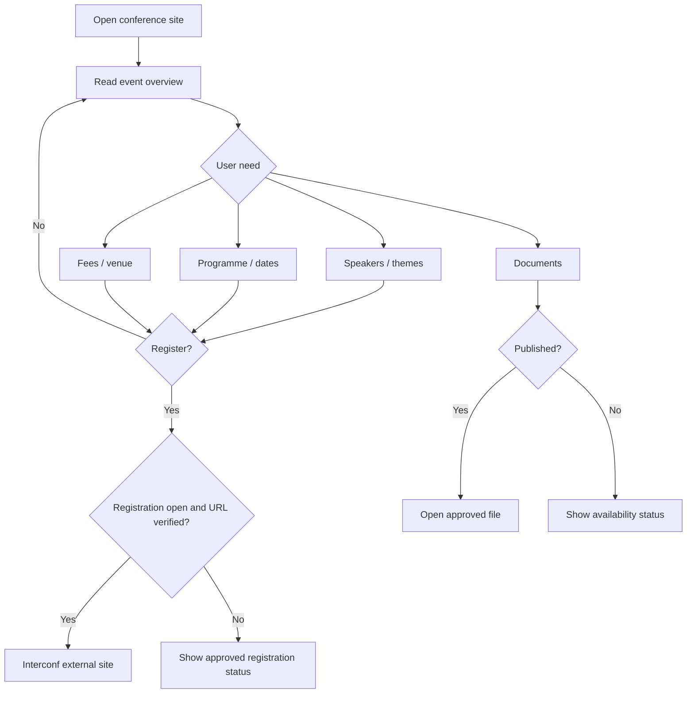
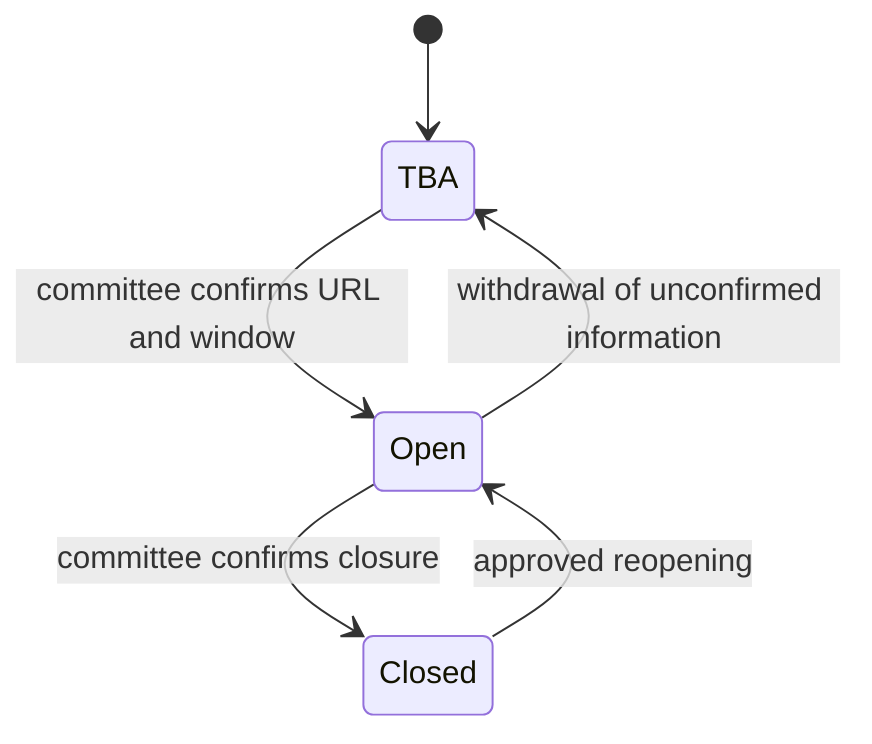

# 09 — User Flow

Version 0.1 | Phase 3 draft | Persona assumptions from Phase 1

## 1. Main visitor flow

Interconf handoff is the end of the microsite's registration flow. Do not claim registration or payment success based on clicking a link.

## 2. Task journeys

| Persona / goal | Flow | Success | FR |
|---|---|---|---|
| Participant registers | Home → Registration → fee/date → CTA → Interconf | Correct event URL or status | 007,033–040,070 |
| Researcher checks call for papers | About/themes → deadlines → approved submission info | Correct official deadline and timezone if applicable | 020–023,033–035 |
| Participant checks agenda | Programme → choose day → read sessions | Correct sessions and room if available | 024–029 |
| Visitor browses speaker | Speakers → category/session → profile | Correct approved data | 013–018 |
| Participant downloads material | Downloads → published item → file | Correct file and language; no fake download | 049–052 |
| Visitor switches language | Any localized page → language control → equivalent page | Same information in new locale | 061,067–069 |
| Mobile visitor navigates | Open menu → select destination → close | Focus usable; route correct | 002–004 |
| Developer updates content | Edit typed data EN/ID → validate → build → review → approved release | No component rewrite, no unapproved data | 071 |

## 3. Interaction / exception states

- Missing registration URL, closed or not announced: show approved status; no dummy hyperlink.
- No confirmed speaker or schedule: approved TBA/empty state, hide optional section where agreed.
- Missing translations: fail validation for required content; never silently invent translations of official facts.
- Unknown route: localized 404 and link to correct home, subject to hosting.
- Mobile menu/accordion/tabs: pointer and keyboard operation, appropriate focus, accessible states, no forced animation.
- External documents and venue links: clearly communicate destination, file type/language when known.

## 4. Validation

Prototype and test primary flows in EN and ID on desktop/mobile. Record user task completion, friction and feedback; mentor reviews before full UI development. No usability study performed yet.

## 6. Detailed interaction contracts

| Flow | Entry | Happy path | Alternative / error | Exit evidence |
|---|---|---|---|---|
| UF-01 Discover | Home | Read hero → overview → programme | TBA date or venue explicitly stated | User can identify conference and next action |
| UF-02 Register | Any CTA | Check availability → official Interconf | closed/TBA: status and approved help, no fake link | Correct event destination; no form here |
| UF-03 Agenda | Programme | Select day → read session → view details | No published session: localized empty state | Selected day and session match data |
| UF-04 Language | Any public route | Choose other locale → equivalent route | No equivalent: defect; do not silently return home | Correct language, URL and back navigation |
| UF-05 Documents | Downloads | Choose published file → open/download | Unpublished or unavailable: status only | File matches title, language and revision |
| UF-06 Venue | Venue | Read address → map or approved accommodation | No confirmed lodging: hide optional section or state | Verified map/hotel destination |
| UF-07 Mobile | Any route | Open menu → select link → close | Escape/close returns focus to trigger | No trapped focus or horizontal overflow |
| UF-08 Content update | Git repository | Update data and both translations → validate → PR → build | Validation failure blocks publish | Reviewed commit and preview |

## 7. Interaction state machine (registration)

Status is explicit published data, not inferred from visitors' device clocks. Optional countdown cannot independently enable registration. If date automation is introduced later, use explicit timezone and deterministic behavior. No participant login local state. For external navigation preserve user control; if new tab is intentional, indicate it and set rel appropriately.

## 8. UX validation protocol

Ask representative participant/researcher and mentor to find fees, switch language from programme, locate deadline, find presentation, reach registration without assistance. Record completion, wrong turns, unclear labels, accessibility barrier and recommended change. Targets proposed: every critical task completable, no misleading status or route; time observations are diagnostic rather than invented pass scores. Use dummy data only on controlled preview and mark it clearly.
