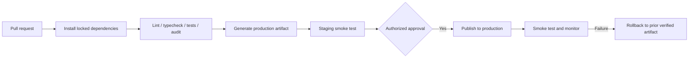

# 12 — Deployment & Handover

Version 0.1 | Phase 6 draft | Host, domain and access TBD; no deployment executed

## 1. Proposed deployment approach

SSG is preferred for the public bilingual microsite, subject to Phase 2 confirmation and IT hosting capabilities. Nuxt static output can be published without a running Node server when all required routes are generated and no runtime server features are used. If scope later requires SSR or runtime API, reassess host and architecture before implementation.

| Item | Decision / status |
|---|---|
| Hosting provider and account | TBD by IT |
| Domain and DNS owner | TBD |
| Staging / production access | TBD |
| Deployment authorization and approver | TBD |
| CI/CD provider | GitHub Actions proposed, subject to repository/IT policy |
| TLS, headers, redirects, 404 and cache policy | TBD by host |
| Previous-release storage / rollback mechanism | TBD by host |

## 2. Candidate build procedure

After inspecting actual scripts, versions and lockfile, use an approved compatible Node runtime. Example for a static Nuxt project (not executed):

```bash
npm ci
# Run configured lint, typecheck and test scripts if present
npm run generate
```

Expected default output `.output/public/` for standard Nuxt generation; verify the project's actual configuration and artifact. If `generate` is not defined, establish the script during architecture/setup review. Review both locale HTML routes, assets, 404 and links before upload. A static host cannot execute Nitro server routes. Do not use server-build commands interchangeably with static publishing.

## 3. Candidate CI/CD workflow



Actual pipeline YAML and credentials depend on host. Use scoped secrets, no secret values in repository or public build. Do not push to main, configure DNS, or deploy without approval. Restrict staging access as appropriate; noindex alone is not access control.

## 4. Release checklist

- [ ] Mentor approves design, applicable scope, official content and both translations.
- [ ] QA gates passed and evidence recorded (see 11); dependency and security review complete.
- [ ] Confirm domain, production base URL, exact Interconf links and status.
- [ ] Check all localized routes, redirects, generated HTML and 404 on selected host.
- [ ] Confirm HTTPS, security headers, caching and production robots/sitemap/canonical/hreflang.
- [ ] Save previous verified release and document rollback steps.
- [ ] Publish only after authorized approval; record commit/tag, artifact, release time and operator.
- [ ] Smoke test EN/ID, navigation, CTA, documents and status; check logs/monitoring if available.

## 5. Rollback and operations

On critical error, broken registration or incorrect official data, notify IT/mentor, restore previous verified artifact via host-supported mechanism, invalidate stale cache if needed, and verify both locales and links. Record incident, cause, resolution and next release approval. Exact commands TBD after host selection. Do not mark rollback tested until rehearsed.

## 6. Handover

Provide repository, README setup/build instructions, content update guide (EN/ID, official approvals), docs index, design/Figma link, CI/CD and host runbook, test report, known issues, dependency review and release record. Transfer access using approved IT process rather than embedding credentials. Explain how to rebuild and update content, change registration status, validate translation parity and roll back. Obtain handover sign-off.

## 7. Detailed production runbook (static host candidate)

| Stage | Operator action | Evidence / abort condition |
|---|---|---|
| Preflight | Confirm authorized release, domain, host, release branch/tag, Node version, actual scripts and credentials | Abort if approval or previous artifact absent |
| Clean build | Install lockfile, run required lint/typecheck/content validation/unit/E2E, generate | Abort on failing required gate |
| Artifact inventory | List all localized HTML, `_nuxt` assets, locale payloads, documents, 404, sitemap and robots; inspect secrets | Abort if missing route or private fixture |
| Staging | Serve identical production candidate in restricted preview (or separate staging build if metadata differs) | Record environment-specific differences, smoke tests |
| Promote | Upload/switch approved artifact atomically where host supports; do not expose intermediate files | Record release hash/tag and operator |
| Verify | HTTPS, 404, both locale routes, registration links and document downloads | Rollback on critical errors |
| Observe | Check errors, availability, cache invalidation and official status | Record incident if unexpected behavior |

Example build sequence after scripts are defined and approved:

```bash
npm ci
npm run lint
npm run typecheck
npm run validate:content
npm run test:unit
npm run generate
# Serve generated artifact using the agreed preview command before E2E.
npm run test:e2e
```

Run `npm run` first to inspect scripts; all commands except npm ci are candidate script contracts. For SSR alternative only after scope change, `npm run build` and a compatible runtime for `.output/server/index.mjs`; not the static deployment workflow.

## 8. Host requirements and Nginx illustration

Candidate static server configuration, **not production-ready without IT review**. Domain and directories below are placeholders. TLS certificates/redirect and headers must be set by IT. Host must support clean path directory indexes and actual 404.

```nginx
server {
    listen 443 ssl;
    server_name conference.example.invalid;
    root /srv/conference/current;
    index index.html;
    # ssl_certificate and ssl_certificate_key: set via IT provisioning
    location / {
        try_files $uri $uri/ =404;
    }
    error_page 404 /404.html;
    location = /404.html { internal; }
}
```

Confirm generated output matches directory structure and error file. Configure HTTPS redirect separately, root locale entry/redirect only once policy approved, and security headers from [17](17-SECURITY.md). Avoid SPA fallback returning 200 for missing pages. Cache hashed `_nuxt` assets long with immutable only when verified content-hashed; HTML and non-hashed metadata/documents short/revalidate; preserve previous hashed assets during rollout if needed. Recheck header inheritance when adding location rules. Do not commit certificates or private keys. For managed static hosting translate these rules to provider config.

## 9. CI/CD workflow contract

PR: checkout reviewed commit; setup approved Node version; npm ci; mandatory checks; generate; serve artifact for E2E; upload test reports/artifact; least-privilege read token. Protected release: approval through environment; download artifact from exact approved commit (or reproducibly rebuild if environment differs); verify hash; deploy with scoped secret; smoke; save release metadata. Separate build credentials from deployment credentials. Pin trusted action versions per IT policy; avoid privileged workflows executing untrusted PR code. No host-specific YAML until provider selected.

## 10. Release record and rollback rehearsal

`release ID | Git SHA/tag | build time | Node/npm | artifact checksum | previous release | host | approver | operator | smoke results | rollback evidence`

Rollback triggers: primary CTA wrong, required route/locale broken, private data exposed, severe accessibility regression or major production availability issue. Notify IT, stop promotion, restore previously verified artifact (host-specific release switch), purge relevant cache, verify SHA and both locales, confirm external CTA and documents. If previous release contains withdrawn/sensitive data, do not blindly restore; coordinate containment. Record elapsed recovery, cause, and re-release approval. Retain at least one prior verified artifact per IT retention policy; no database restore in MVP.

## 11. Maintenance schedule (proposed)

| Cadence | Check |
|---|---|
| Before every content update | Official EN/ID data, registration link/status, assets, build, preview approval |
| During active conference period | Agreed uptime and critical-link checks; event updates with approval |
| Weekly while maintained | Review errors, broken links and dependency notices |
| Monthly / before release | Review dependencies, performance and security headers |
| After event | Confirm archived status, document publication, registration closure and retention with committee |

Critical security findings and wrong official content handled immediately through authorized incident process. No always-on monitoring service has been configured. See [release audit](20-FINAL-RELEASE-READINESS-AUDIT.md).
