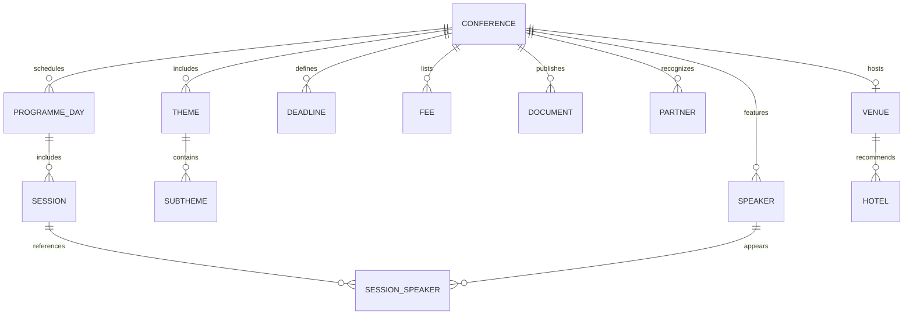

# 13 — Data Architecture & Content Contracts

Version 0.3 | Minimal Phase 2 validator verified | Production schema draft

## Implemented proof of concept

- `app/types/conference.ts` defines `Locale`, `Localized<T>`, `ConferenceConfig`, and `Speaker`. `Registration` requires a URL for `open` and excludes it for `tba` and `closed`. `LoginAvailability` models availability independently.
- `app/utils/content-validation.ts` accepts unknown input and reports malformed or duplicate IDs, missing or blank translations, invalid states, and invalid active-link URLs. It validates absolute HTTPS syntax and rejects credentials. The official event host/path policy and human approval are production gates.
- `tests/fixtures/conference.ts` holds synthetic data and a reserved `.example` URL. It lives outside the app and is imported only by the tests. The verification page renders catalog messages and has no event or credential data.
- `npm run test:content` uses `node --test`. Five tests passed with exit 0, including the case of closed registration and available login. Domain contracts and examples below describe the broader production design.

## 1. Source of truth

Content is versioned in Git and rendered at build time. Use stable IDs and shared non-language fields to avoid inconsistent fees, dates and speaker identities. UI messages live separately from conference records. No credentials, participant records, payment information or private submissions in data files: all imported data can become publicly accessible via generated HTML or JS payloads. Only publish approved data. A draft record is not private merely because a UI hides it.



Logical relationships only, not SQL tables. `registration`, contacts and metadata are conference-level records. One conference per deployment in MVP.

## 2. Candidate source layout

```text
app/data/
  conference.ts       # identity, date, timezone, contacts, registration
  speakers.ts         # stable speaker IDs
  themes.ts           # themes and subthemes
  programme.ts        # days, sessions, speaker references
  important-dates.ts  # deadline records
  fees.ts             # categories, prices, currency
  venue.ts            # venue and hotels
  documents.ts        # approved downloadable files
  partners.ts         # logo records
app/types/conference.ts
app/utils/{content-validation,format-date,format-money,safe-url}.ts
```

Names and implementation to be reconciled against actual repository; no files here have been implemented.

## 3. Proposed TypeScript contracts

```ts
export type Locale = 'en' | 'id'
export type Localized<T = string> = Record<Locale, T>
export type Publication = 'tba' | 'published' | 'withdrawn'
export type SpeakerStatus = 'confirmed' | 'tbc'
export type RegistrationStatus = 'tba' | 'open' | 'closed'
export type Currency = 'IDR' | 'USD'
export interface MediaAsset {
  src: string
  alt: Localized
  width: number
  height: number
}
export interface Conference {
  id: string
  title: Localized
  theme: Localized
  overview: Localized
  timezone: string // IANA, approved by committee
  startsAt?: string // ISO 8601 timestamp with offset
  endsAt?: string
  status: Publication
  registration: Registration
  login: LoginAvailability
}
export type Registration =
  | { status: 'open'; url: string }
  | { status: 'tba' | 'closed'; url?: never }
export type LoginAvailability =
  | { status: 'available'; url: string }
  | { status: 'unavailable'; url?: never }
export interface Speaker {
  id: string
  name: string
  role: Localized
  institution: Localized
  photo?: MediaAsset
  bio?: Localized
  status: SpeakerStatus
}
export interface Theme {
  id: string
  title: Localized
  description: Localized
  subthemes: { id: string; title: Localized; description?: Localized }[]
}
export interface ProgrammeDay {
  id: string
  date: string // ISO calendar date in event timezone
  sessions: Session[]
}
export interface Session {
  id: string
  title: Localized
  description?: Localized
  startsAt: string
  endsAt: string
  room?: Localized
  speakerIds: string[]
}
export interface Deadline {
  id: string
  title: Localized
  date?: string
  status: Publication
}
export interface Fee {
  id: string
  category: Localized
  status: Publication
  amount?: number // major currency unit, nonnegative; validate precision
  currency?: Currency
  note?: Localized
}
export interface ConferenceDocument {
  id: string
  title: Localized
  fileLanguage: Locale | 'both'
  format: 'PDF' | 'PPTX' | 'DOCX'
  status: Publication
  url?: string
  revision?: string
}
export interface Partner {
  id: string
  name: Localized
  logo: MediaAsset
  category: 'organizer' | 'partner' | 'sponsor'
  url?: string
}
export interface Venue {
  name: Localized
  address: Localized
  mapUrl?: string
  photo?: MediaAsset
  hotels: Hotel[]
}
export interface Hotel {
  id: string
  name: string
  address?: Localized
  rate?: { amount: number; currency: Currency; note: Localized }
  contact?: string
  url?: string
}
```

Use `satisfies` on data declarations to catch missing fields; runtime validation still needed for nonempty strings, duplicate IDs, valid dates, valid references and semantic conditions. Decide whether additional statuses are needed during Phase 2; unify availability naming across architecture drafts before coding.

## 4. Validation invariants

| Rule | Failure action |
|---|---|
| IDs unique within each entity collection; session speaker references exist | Fail build/content check |
| Required EN/ID strings nonempty and reviewed; no raw i18n key in UI | Fail release |
| Dates parse and timezone matches approved event; end >= start | Fail data validation |
| Session ordering by start time; overlaps may be valid parallel sessions | Flag overlaps for committee, never silently delete |
| Published fees have currency and nonnegative amount; zero means free only when confirmed | Fail release if inconsistent |
| Registration open implies approved HTTPS event URL, no legacy CPRN URL | Fail release |
| Published documents have approved path/URL and matching format; missing file rejected | Fail release |
| TBA fields do not contain fabricated official details; unpublished URLs not emitted | Fail review |
| Media dimensions positive; asset exists and rights approved | Fail review or use approved fallback |
| Private/draft data absent from source imported by public bundle | Block release |

## 5. Date, currency and ordering

Store instants with explicit offsets and conference IANA timezone; display via Intl.DateTimeFormat with explicit timezone. For date-only values, parse as calendar dates rather than implicit local instants. Format currency via Intl.NumberFormat per locale; do not calculate FX or modify amount when locale changes. Stable sorting by timestamp and ID; unknown deadline listed separately. Avoid using browser local clock for initial HTML. Unit tests use fixed clocks for optional countdown.

## 6. Data access and update example

```ts
const title = conference.title[locale] // locale narrowed to en | id
const sessionSpeakers = session.speakerIds.map(id => speakerById.get(id))
```

Validation runs before selectors; missing references must not be silently ignored. Pages receive localized models through selectors; shared UI accepts simple props. No mutation of source records in browser. For updating data, follow [editorial workflow](15-CONTENT-EDITORIAL.md). For migration to CMS, open change request, define separate adapter and security model, then reassess rendering. Do not build speculative DB migrations.
