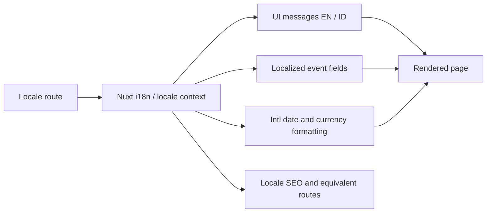

# 14 — Bilingual Translation & Internationalization

Version 0.3 | Phase 2 PoC | Production translations and SEO pending

## 1. Architecture



Unlike the supplied institutional CMS, this site has no translation service, API key, database columns or automated runtime machine translation. AI may assist drafting offline if institutional policy permits; bilingual publication requires human review. UI text and content use separate sources, but both follow same glossary.

## 2. Nuxt i18n proof of concept

The project uses `@nuxtjs/i18n 10.7.0`, the `prefix` strategy, EN default, and browser detection disabled. One `app/pages/index.vue` produces both locale pages. The root is excluded from prerender. Production redirect and error behavior depend on the approved host.

Relevant options from the PoC:

```ts
export default defineNuxtConfig({
  modules: ['@nuxtjs/i18n'],
  i18n: {
    strategy: 'prefix',
    defaultLocale: 'en',
    detectBrowserLanguage: false,
    locales: [
      { code: 'en', language: 'en', name: 'English', file: 'en.json' },
      { code: 'id', language: 'id', name: 'Bahasa Indonesia', file: 'id.json' }
    ]
  }
})
```

Nuxt generated both catalogs from `i18n/locales/` under `.output/public/_i18n/7e57d1ca/{en,id}/messages.json`. The hash may change with message inputs. The switcher uses `useSwitchLocalePath`, and the layout sets the HTML language from the active locale. A local Chrome run verified both switches in the same document and fetched both catalogs as HTTP 200 responses from static files. Production canonical, alternate metadata and sitemap remain part of the proposed SEO contract. [Nuxt i18n usage](https://i18n.nuxtjs.org/docs/getting-started/usage) · [Nuxt i18n options](https://i18n.nuxtjs.org/docs/api/options)

## 3. UI messages and naming convention

```json
{
  "nav": { "home": "Home", "programme": "Programme" },
  "registration": { "register": "Register now", "closed": "Registration closed", "tba": "To be announced" },
  "documents": { "unavailable": "Not yet available" }
}
```

ID counterpart:

```json
{
  "nav": { "home": "Beranda", "programme": "Agenda" },
  "registration": { "register": "Daftar sekarang", "closed": "Registrasi ditutup", "tba": "Akan diumumkan" },
  "documents": { "unavailable": "Belum tersedia" }
}
```

Namespaced semantic keys (`nav`, `common`, `programme`, `speaker`, `registration`, `venue`, `documents`, `seo`, `errors`). Avoid hardcoding text in templates, concatenate translated sentences or translate official names without authorization. Validate exact key parity, interpolation variables and nonempty values. Fallback is for controlled recovery, not a release exemption; fail missing required translations before production.

## 4. Locale navigation and SEO

Use locale-aware route helpers (`useLocalePath`, `useSwitchLocalePath`) rather than replacing substrings manually. Language switch from programme EN goes to programme ID, including equivalent anchor where meaningful. Preserve selected day only when supported by explicit stable query/state; do not guarantee persistence until UX decision. Current locale determined by route, not stale local storage. Set HTML `lang`, localized title/description, canonical self URL, reciprocal alternate hreflang for EN/ID and optional x-default only if meaningful. Generate sitemap for both languages; no duplicate canonical to EN from ID. Production base URL TBD. Verify actual HTML, not just browser DOM.

## 5. Glossary seed (review required)

| English | Indonesian |
|---|---|
| Early Childhood Care and Education | Pendidikan dan Pengasuhan Anak Usia Dini (terminology from institutional reference; confirm official usage) |
| Conference | Konferensi |
| Keynote Speaker | Pembicara Utama |
| Plenary Session | Sesi Pleno |
| Programme | Agenda |
| Important Dates | Tanggal Penting |
| Abstract Submission | Pengumpulan Abstrak |
| Registration Fees | Biaya Registrasi |
| Accommodation | Akomodasi |
| To be confirmed | Menunggu konfirmasi |
| To be announced | Akan diumumkan |

Keep SEAMEO CECCEP, Interconf and verified institutional names unchanged unless approved official translation exists. Review terminology with committee; no automated translation is official without approval.

## 6. Editorial translation flow

1. Obtain approved source text, record source revision and owner.
2. Draft other locale; protect names, numbers, date, fee, URLs and acronyms.
3. Bilingual reviewer compares meaning, glossary, punctuation and official names.
4. Update both locale messages/records in same PR; review parity and metadata.
5. Generate preview, inspect long Indonesian and English strings, dates and layout.
6. Committee approves both locales; build release. On change, update both or hold publication until approved exception.

## 7. Verification

Test EN/ID key parity; all direct URLs; switch from every route; back/forward; reload and bookmarking; no mixed language in public controls; localized empty/404 states; date/fee equality; document language indicator; HTML lang/canonical/hreflang; static message delivery and no missing translations in console. Record examples in [UAT](19-UAT-TESTING-PLAN.md). No runtime translation provider or external API until scope change.
