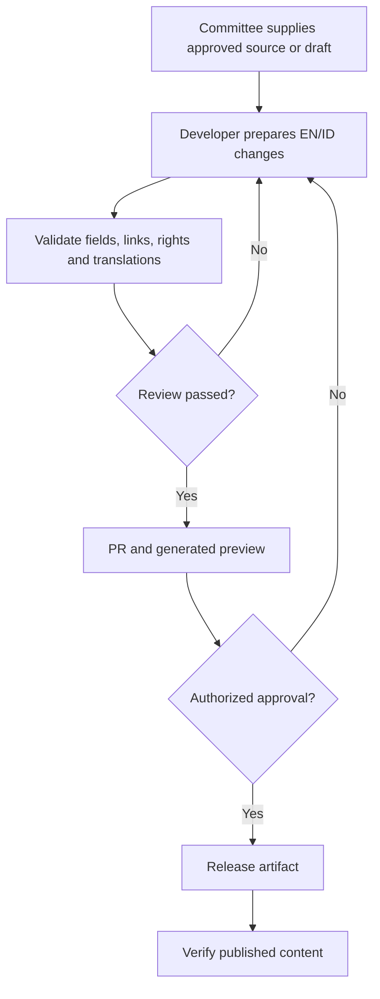

# 15 — Source-Code Content & Editorial Operations

Version 0.2 | Draft | Alternative to CMS/RBAC; content updates require repository access.

## 1. Roles (operational, not application authentication)

| Role | Responsibility | Access boundary |
|---|---|---|
| Conference committee | Confirm official data, event statuses and assets | Supplies content; no need for Git write access |
| Bilingual reviewer | Review EN/ID meaning and terminology | Review documents or PR per team policy |
| Developer | Update data, locale files, assets; validate and prepare PR | Branch access per repository policy |
| Mentor / designated approver | Approve scope, visual design, content release | Reviews evidence; approval authority to confirm |
| IT maintainer | Manage host, deployment, DNS, access and rollback | Authorized deployment environment only |
| Visitor | Read public content, follow approved links | No local account, no write access |

No local Super Admin/Admin/Editor, password gateway or application RBAC. Git/release permissions must be managed using organization policy. Actual assignments TBD.

## 2. Content inventory and owner checklist

| Data module | Required inputs | Validation / owner |
|---|---|---|
| Conference | Name, theme, dates, timezone, venue, overview, objectives EN/ID | Committee confirms approved wording |
| Speakers | Name, title, institution, session, status, portrait consent | Committee/speaker representative |
| Themes | Main theme, subthemes, descriptions | Academic committee |
| Programme | Day, start/end, session type, room, speakers, timezone | Programme committee |
| Deadlines | Submission/registration dates and status | Committee |
| Fees | Categories, amount, currency, conditions | Registration committee |
| Interconf | New event URL, login URL, registration status | Authorized coordinator |
| Venue / hotels | Address, image, official map, period rates, contact/form | Logistics |
| Documents | Approved version, file language/type, public permission | Document owner |
| Partners | Approved institution names, categories, logo usage | Partnership coordinator |
| Contact | Official email/phone/channel, privacy notice if needed | Communications |
| SEO | Page descriptions, og image, canonical base URL | Communications + IT |

## 3. Content lifecycle and approval

Draft content remains in controlled private workspace; never commit sensitive data to repo or include unpublished details in public build. Only approved placeholders are publishable. Use TBA/closed status not guessed dates or disabled `#` links. If content changes urgently, follow same review gate with expedited authorized approval.

## 4. How to update a conference

1. Read source contracts and existing records; do not edit UI to change an event fact.
2. Create branch `content/<event>-<topic>` after checking clean Git state.
3. Update shared fields and both translations; preserve stable IDs and referenced records.
4. Add approved asset to public directory using readable kebab-case filenames; optimize image without altering identity; record owner/license separately in approved records.
5. Run content checks, typecheck and generate using configured scripts. Open both locales and test affected routes/links.
6. Submit PR with source approval reference, screenshots EN/ID, test evidence and known limitations. Do not include private correspondence in public docs.
7. Authorized reviewer approves; publish through approved release workflow. Verify changes and record release commit.

## 5. Asset manifest template

| Asset path | Type | Rights/approval reference | Alt EN | Alt ID | Version | Status |
|---|---|---|---|---|---|---|
| TBD | Logo / photo / PDF | TBD | TBD | TBD | TBD | Pending |

No dummy speaker portrait or event logo presented as real. PDF includes accessible text where possible; indicate language and format, use official files. Remove withdrawn documents from new build and check whether old cached files require purge; if sensitive, alert IT, because removing a link alone does not remove cached public files.

## 6. Handover procedure

Maintain data dictionary, approved asset source and bilingual glossary, content owner and release history. Demonstrate one representative event update on a controlled preview, verify no component source changed, then restore fixture if needed. Do not create CMS until explicitly approved and security/design scope updated.
