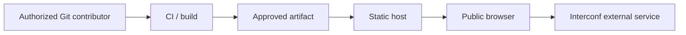

# 17 — Security Architecture & Privacy

Version 0.4 | 2026-11-27 | Phase 2 dependency triage complete | Production security sign-off pending

## Phase 2 dependency verification

The installation ran with the project's existing script policy. npm blocked a nested `esbuild@0.25.12` postinstall under `@intlify/bundle-utils`. The existing exception for `esbuild@0.28.2` was retained. Clean offline install in a local temporary copy, typecheck, and static generation completed under this policy. Clean CI verification should use the same policy.

### Advisory and installed paths

On application commit `595808f` with Node `24.15.0` and npm `11.12.1`, `npm audit --json --fetch-retries=0 --fetch-timeout=12000 --logs-max=0` reached the npm registry and returned exit `1`. It reported **nine moderate entries**, zero high and zero critical. `npm ls minimatch --all --logs-max=0` and `npm explain minimatch --logs-max=0` both returned exit `0` and agreed with the lockfile.

| Installed copy | Dependency paths from the application | Advisory status |
|---|---|---|
| `10.2.6` under `node_modules/readdir-glob/node_modules/minimatch` | `nuxt@4.7.0` → `@nuxt/nitro-server@4.7.0` → `nitropack@2.14.0` → `archiver@8.0.0` → `readdir-glob@3.0.0` → `minimatch@10.2.6` | Affected, the only installed copy within the advisory range |
| `11.0.9` at `node_modules/minimatch` | `@nuxtjs/i18n@10.7.0` → `@intlify/unplugin-vue-i18n@11.2.8` → `@typescript-eslint/typescript-estree@8.74.0` → `minimatch@11.0.9`. Shared by `nuxt` → `@nuxt/nitro-server` → `nitropack` → `@vercel/nft@1.11.12` → `glob@14.0.6` → the same `11.0.9` copy. | Outside the affected range |

The nine entries are `minimatch@10.2.6`, `readdir-glob@3.0.0`, `archiver@8.0.0`, `nitropack@2.14.0`, `nuxt@4.7.0`, `@nuxt/nitro-server@4.7.0`, `@nuxt/nitro-v3-server@4.7.0`, `@nuxt/vite-builder@4.7.0`, and `@nuxt/vite-server@4.7.0`. Nuxt is the direct project dependency flagged by audit. The other eight entries are transitive, including propagation through Nuxt peers. `@nuxtjs/i18n` is also a direct project dependency and reaches the unaffected deduplicated copy. The underlying advisory covers `>=7.0.0 <11.0.1`, with first patched version `11.0.1`. It concerns availability through excessive CPU and memory use when an attacker controls the glob pattern and `optimizationLevel >= 2`. [Maintainer advisory GHSA-g3hv-75wg-m249](https://github.com/isaacs/minimatch/security/advisories/GHSA-g3hv-75wg-m249)

### Exposure and reachability

| Boundary | Evidence and assessment |
|---|---|
| Build tooling | The affected package is installed in the dependency tree. In installed Nitro `2.14.0`, the `archiver` call found in `dist/presets/azure/utils.mjs` is for Azure packaging. It passes a fixed glob to `archive.glob()`. The artifact records preset `static`. The application and Nuxt configuration do not wire uploads, user-supplied patterns, or archive jobs. |
| Matching options | The installed `readdir-glob@3.0.0` passes glob, ignore, and skip patterns to `Minimatch` with selected options. In `src/index.ts` it does not pass `optimizationLevel` in any of those calls. Installed `10.2.6` defaults to level `1` in `dist/commonjs/index.js`. The advisory's triggering conditions were not found on this inspected call path. The review used source tracing without a denial-of-service reproduction. |
| Public runtime | The generated artifact contains only static public files, with no `.output/server` entry. The application import review found no affected package imports or public request handler that forwards input to a glob. A scan of 20 generated text assets including all six JS chunks found no package names or distinctive matching code markers (`globParts`, `firstPhasePreProcess`, `secondPhasePreProcess`, `optimizationLevel`). There were no source maps. Together these checks found no evidence the affected code is shipped to the browser. Repeat the artifact check against the release candidate. |
| Residual risk | Build dependencies remain installed and available to Node tooling. Changes to presets, dependency call sites, CI checkout/configuration, or future import/glob features require reassessment. Host behavior and CI controls have yet to be verified. |

### Remediation and disposition

Read-only `npm view` queries returned exit `0` on 2026-11-27. `readdir-glob@4.0.0` requires Node `>=20` and depends on `minimatch ^11.0.1`. The installed `archiver@8.0.0` is already the registry's latest and still requires `readdir-glob ^3.0.0`. The registry's latest `nitropack@2.14.0` requires `archiver ^8.0.0`, and the latest `nuxt@4.7.0` still depends on `@nuxt/nitro-server@4.7.0`. The latest published `minimatch` 10.x was `10.2.6`. No patched in-range resolution was identified for the affected branch. Adding or updating the top-level `minimatch` copy would leave the nested copy constrained to 10.x. npm's suggested Nuxt `4.6.3` is outside the manifest range `^4.6.4`.

1. Prefer a supported upstream dependency chain that adopts the patched matcher. After developer approval, verify engine and framework constraints, lockfile diff, clean install on the agreed runner, dependency tree and audit, typecheck, content tests, generate and static smoke tests. Review packaging too if the selected host requires it.
2. If an upstream fix is unavailable and IT requires remediation before release, evaluate a targeted `readdir-glob@4` replacement in a separately approved change. It crosses the range declared by `archiver`. Its Node floor fits the reviewed runtimes, while API and archive behavior compatibility require tests. Forcing `minimatch@11` under `readdir-glob@3` likewise crosses a major range and is lower priority than a supported parent update.
3. Until disposition, keep patterns and build config under reviewed source control. Use isolated, time-limited CI jobs for untrusted changes, with least-privilege credentials and no production secrets. Developer and IT should re-audit in Phase 5 and document remediation or a time-bounded acceptance with owner and reassessment date by the Phase 6 release review. These are recommended controls pending CI and IT approval.

The residual build-tool risk is moderate and awaits remediation or documented acceptance. The reviewed path can support Phase 3 UI/UX design. Release remains gated on security disposition, verified deployment controls, and official links.

The PoC validator checks HTTPS URL form and rejects embedded credentials. Before enabling an Interconf link, verify the exact approved hostname, event path and destination, including redirects if applicable. Production headers, TLS and access controls await the host.

## 1. System boundary and threat model



Trust boundaries: Git account, dependency registry/build runner, artifact storage, hosting/DNS and external site. There is no local auth, SQL, admin gateway, upload endpoint or payment. These risks are not inherited from the Laravel portal; adding backend requires a fresh threat model.

| Threat | Control | Verification |
|---|---|---|
| Supply chain package compromise | Lockfile, reviewed dependency changes, npm audit triage, inspect install scripts | CI logs and dependency review |
| Credential leak | No secrets in docs/client config/public; scoped CI credentials | Secret scan, inspect artifact and Git changes |
| Stored/DOM XSS via event content | Vue text interpolation; avoid v-html; sanitize approved rich content if introduced | Malicious fixture escaped, code review |
| Malicious external URL | HTTPS and exact approved host/path policy; no javascript/data URL | Negative unit tests, manual approved URL review |
| Clickjacking | CSP frame-ancestors via hosting; optional compatible X-Frame-Options | HTTP header inspection |
| Mixed content | HTTPS asset and external link review | Browser console and network |
| Tampered artifact or unauthorized deploy | Protected branch, reviewed PR, scoped credentials, approval gate, immutable artifacts | CI/release logs and commit hashes |
| Public disclosure of unpublished data | Exclude private data at source/build; artifact inspect | Review source and generated payloads |
| DNS/TLS failure | IT-managed DNS and valid cert; monitoring | HTTPS smoke test |
| Tracking without consent | Analytics disabled until policy approved; minimize collection | Network request and privacy review |

## 2. Header policy (host-specific draft)

Candidate header objectives: `X-Content-Type-Options: nosniff`, `Referrer-Policy: strict-origin-when-cross-origin`, `Permissions-Policy: camera=(), microphone=(), geolocation=()`, CSP `frame-ancestors 'none'` if embedding not required, `X-Frame-Options: DENY` where compatible. Enable HSTS only after HTTPS and affected domain policy verified; do not add includeSubDomains or preload without IT approval.

CSP candidate in report-only mode for staging, not copy-paste final:

```http
Content-Security-Policy-Report-Only: default-src 'self'; object-src 'none'; base-uri 'self'; frame-ancestors 'none'; script-src 'self'; style-src 'self'; img-src 'self' data:; font-src 'self'; connect-src 'self'; form-action 'self'
```

Nuxt generated inline scripts/styles or approved external images may need hashes or specific sources; inspect actual output and adjust narrowly. Configure report destination if approved; review browser violations even without collector. Do not add unsafe-eval or broad wildcard by default. Move to enforcing CSP only after both locale routes and all interactions pass. A static host cannot execute server middleware; configure headers at CDN/web server. Ensure headers on 404 as applicable. Document exceptions and owner.

## 3. Data privacy and content handling

- Microsite does not accept login, participant profile, payment, paper submission or contact form in MVP. Public official email/links only.
- No secrets in `runtimeConfig.public`, locale JSON, public assets, environment examples, screenshots or Markdown. Do not copy sample credentials from the source documentation. Treat any actual shared passwords/passcodes as exposed; inform IT and rotate if live.
- External links identify destination; avoid sending sensitive query strings. If opening new tab use appropriate rel and indication.
- Use no unapproved remote fonts, trackers, embedded maps/video or third-party scripts. Prefer locally licensed assets and external links.
- Analytics remains Should, conditional on approval of provider, privacy notice, collection scope, retention and applicable consent. No claim of legal compliance solely based on technical controls.

## 4. Dependency and Git workflow

Run `npm audit` and optionally `npm audit --omit=dev` (dev/build risks still matter). Record package, severity, affected path, exploitability, mitigation and owner. Do not blindly use `npm audit fix --force` or approve blocked install scripts; verify necessity, package provenance and compatibility. No unresolved critical security issue at release; major/high findings require documented disposition and approval. Restrict Git/CI tokens, use MFA where supported, avoid secrets in command history; revoke access on handover according to IT policy. Pin runtime and lockfile; review workflow permission scopes. Use approved scanner; do not actively scan third-party Interconf without authorization.

## 5. Security verification checklist

- [ ] Source and static artifact checked for secrets/private content.
- [x] Phase 2 dependency report reviewed and findings tracked.
- [ ] Re-audit the release candidate and record remediation or authorized risk acceptance.
- [ ] Unsafe links rejected; raw HTML avoided or sanitized.
- [ ] HTTPS, CSP, headers, cache policy verified on staging and production.
- [ ] No local participant auth/data endpoint or unapproved trackers.
- [ ] Deployment approval, access and rollback permissions documented.
- [ ] Security review signed off with evidence and exceptions.

Security incident runbook: notify IT and mentor; record affected release/time without spreading credentials; contain via authorized rollback/disable link; revoke exposed keys or rotate credentials; verify cleanup and caches; document root cause and approval before republish.
