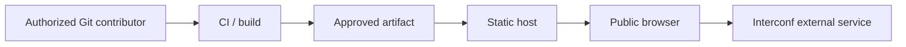

# 17 — Security Architecture & Privacy

Version 0.3 | Local PoC audit results and proposed production controls

## Phase 2 dependency verification

The installation ran with the project's existing script policy. npm blocked a nested `esbuild@0.25.12` postinstall under `@intlify/bundle-utils`. The existing exception for `esbuild@0.28.2` was retained. Clean offline install in a local temporary copy, typecheck, and static generation completed under this policy. Clean CI verification should use the same policy.

`npm audit --json` returned exit 1 on the installed tree and reported nine moderate entries, with zero high or critical entries. The report lists one underlying advisory for `minimatch` under `readdir-glob`, with related entries for `archiver`, `nitropack`, `nuxt`, and four `@nuxt/*` packages. npm suggested Nuxt 4.6.3 outside the current manifest range. Review build-time and runtime exposure and select any dependency change with developer approval. The static output does not deploy a Nitro server. Build-time exposure still needs review. [Advisory GHSA-g3hv-75wg-m249](https://github.com/advisories/GHSA-g3hv-75wg-m249)

The PoC validator checks HTTPS URL form and credentials. Official hostname, event destination, and release approval still need to be defined when authorized Interconf links arrive. Production headers, TLS and access controls await the host.

## 1. System boundary and threat model



Trust boundaries: Git account, dependency registry/build runner, artifact storage, hosting/DNS and external site. There is no local auth, SQL, admin gateway, upload endpoint or payment. These risks are not inherited from the Laravel portal; adding backend requires a fresh threat model.

| Threat | Control | Verification |
|---|---|---|
| Supply chain package compromise | Lockfile, reviewed dependency changes, npm audit triage, inspect install scripts | CI logs and dependency review |
| Credential leak | No secrets in docs/client config/public; scoped CI credentials | Secret scan, inspect artifact and Git changes |
| Stored/DOM XSS via event content | Vue text interpolation; avoid v-html; sanitize approved rich content if introduced | Malicious fixture escaped, code review |
| Malicious external URL | HTTPS and exact approved host/path policy; no javascript/data URL | Negative unit tests, manual approved URL review |
| Clickjacking | CSP frame-ancestors via hosting; optional compatible X-Frame-Options | HTTP header inspection |
| Mixed content | HTTPS asset and external link review | Browser console and network |
| Tampered artifact or unauthorized deploy | Protected branch, reviewed PR, scoped credentials, approval gate, immutable artifacts | CI/release logs and commit hashes |
| Public disclosure of unpublished data | Exclude private data at source/build; artifact inspect | Review source and generated payloads |
| DNS/TLS failure | IT-managed DNS and valid cert; monitoring | HTTPS smoke test |
| Tracking without consent | Analytics disabled until policy approved; minimize collection | Network request and privacy review |

## 2. Header policy (host-specific draft)

Candidate header objectives: `X-Content-Type-Options: nosniff`, `Referrer-Policy: strict-origin-when-cross-origin`, `Permissions-Policy: camera=(), microphone=(), geolocation=()`, CSP `frame-ancestors 'none'` if embedding not required, `X-Frame-Options: DENY` where compatible. Enable HSTS only after HTTPS and affected domain policy verified; do not add includeSubDomains or preload without IT approval.

CSP candidate in report-only mode for staging, not copy-paste final:

```http
Content-Security-Policy-Report-Only: default-src 'self'; object-src 'none'; base-uri 'self'; frame-ancestors 'none'; script-src 'self'; style-src 'self'; img-src 'self' data:; font-src 'self'; connect-src 'self'; form-action 'self'
```

Nuxt generated inline scripts/styles or approved external images may need hashes or specific sources; inspect actual output and adjust narrowly. Configure report destination if approved; review browser violations even without collector. Do not add unsafe-eval or broad wildcard by default. Move to enforcing CSP only after both locale routes and all interactions pass. A static host cannot execute server middleware; configure headers at CDN/web server. Ensure headers on 404 as applicable. Document exceptions and owner.

## 3. Data privacy and content handling

- Microsite does not accept login, participant profile, payment, paper submission or contact form in MVP. Public official email/links only.
- No secrets in `runtimeConfig.public`, locale JSON, public assets, environment examples, screenshots or Markdown. Do not copy sample credentials from the source documentation. Treat any actual shared passwords/passcodes as exposed; inform IT and rotate if live.
- External links identify destination; avoid sending sensitive query strings. If opening new tab use appropriate rel and indication.
- Use no unapproved remote fonts, trackers, embedded maps/video or third-party scripts. Prefer locally licensed assets and external links.
- Analytics remains Should, conditional on approval of provider, privacy notice, collection scope, retention and applicable consent. No claim of legal compliance solely based on technical controls.

## 4. Dependency and Git workflow

Run `npm audit` and optionally `npm audit --omit=dev` (dev/build risks still matter). Record package, severity, affected path, exploitability, mitigation and owner. Do not blindly use `npm audit fix --force` or approve blocked install scripts; verify necessity, package provenance and compatibility. No unresolved critical security issue at release; major/high findings require documented disposition and approval. Restrict Git/CI tokens, use MFA where supported, avoid secrets in command history; revoke access on handover according to IT policy. Pin runtime and lockfile; review workflow permission scopes. Use approved scanner; do not actively scan third-party Interconf without authorization.

## 5. Security verification checklist

- [ ] Source and static artifact checked for secrets/private content.
- [ ] Dependency report reviewed and findings tracked.
- [ ] Unsafe links rejected; raw HTML avoided or sanitized.
- [ ] HTTPS, CSP, headers, cache policy verified on staging and production.
- [ ] No local participant auth/data endpoint or unapproved trackers.
- [ ] Deployment approval, access and rollback permissions documented.
- [ ] Security review signed off with evidence and exceptions.

Security incident runbook: notify IT and mentor; record affected release/time without spreading credentials; contain via authorized rollback/disable link; revoke exposed keys or rotate credentials; verify cleanup and caches; document root cause and approval before republish.
